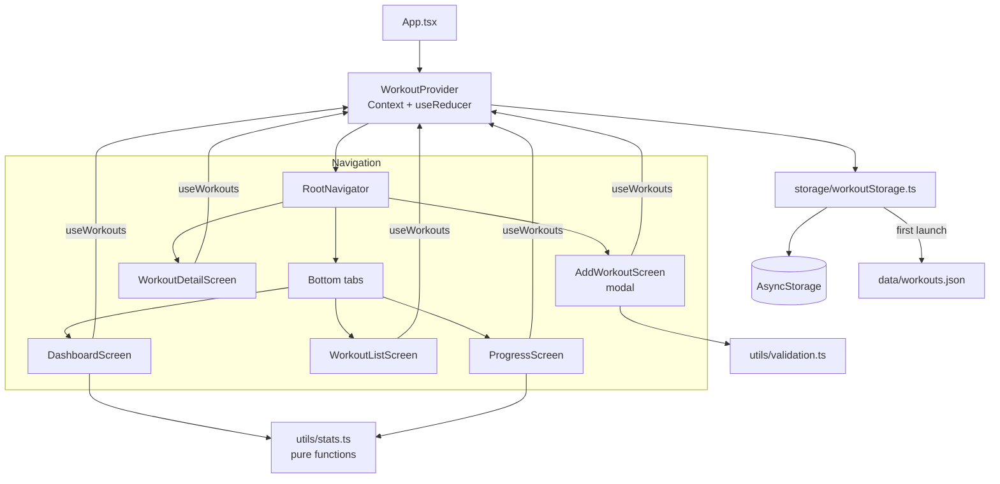

# Fitness Tracker Mobile

A cross-platform fitness tracking app built with React Native, Expo and TypeScript. Log workouts, review weekly stats and follow your progress in charts.

> **Note:** This is a demo / learning project. All data is stored locally on the device and the bundled workouts are fictional sample data.

## Features

- **Dashboard**: weekly goal progress, workouts / active time / calories / distance with change vs. last week, current streak, active minutes per day and recent workouts
- **Workout log**: grouped by week with per-week totals, filterable by activity (running, cycling, strength, yoga)
- **Add workout**: validated form with activity and intensity pickers, quick "Today / Yesterday" dates, and MET-based calorie estimates when calories are left blank
- **Workout detail**: duration, distance, pace or speed, heart rate, intensity, strength exercises with total lifted volume, notes, and delete
- **Progress charts**: weekly trend (line chart), daily totals for the last 14 days (bar chart), activity mix (pie chart) and personal bests
- **Local persistence** with AsyncStorage. On first launch the sample data is loaded and its dates are shifted so the latest workout falls on today.
- **Typed navigation** with React Navigation 7: bottom tabs inside a native stack, with "Add workout" shown as a modal
- **Unit tests** for stats, date, formatting and form validation utilities

## Tech Stack

| Area        | Library                                                  |
| ----------- | -------------------------------------------------------- |
| Framework   | React Native 0.76 + Expo SDK 52                          |
| Language    | TypeScript (strict)                                      |
| Navigation  | React Navigation 7 (native stack + bottom tabs)          |
| Charts      | react-native-chart-kit (on top of react-native-svg)      |
| Storage     | @react-native-async-storage/async-storage                |
| State       | React Context + `useReducer`                             |
| Icons       | @expo/vector-icons (Ionicons)                            |
| Testing     | Jest + jest-expo                                         |

## Architecture



Business logic (aggregation, streaks, personal bests, calorie estimates, validation) lives in pure functions under `src/utils`, so it is easy to unit test without rendering components.

## Project Structure

```
fitness-tracker-mobile/
├── App.tsx                     # Providers + navigator
├── index.ts                    # Expo entry point (registerRootComponent)
├── app.json                    # Expo configuration
├── __tests__/
│   ├── stats.test.ts           # Stats utilities + seed data sanity checks
│   └── utils.test.ts           # Date, format and validation utilities
└── src/
    ├── components/             # StatCard, WorkoutCard, ChartCard, ChipGroup, ...
    ├── constants/activities.ts # Activity labels, colours, icons, MET values
    ├── context/WorkoutContext.tsx
    ├── data/workouts.json      # ~30 days of sample workouts
    ├── navigation/             # RootNavigator + typed param lists
    ├── screens/                # Dashboard, WorkoutList, WorkoutDetail, AddWorkout, Progress
    ├── storage/workoutStorage.ts
    ├── theme/index.ts          # Colours, spacing, radii, shadows
    ├── types/workout.ts
    └── utils/                  # stats.ts, date.ts, format.ts, validation.ts
```

## Getting Started

### Prerequisites

- [Node.js](https://nodejs.org/) 18 or newer (20 LTS recommended)
- The **Expo Go** app on an iOS/Android device, or an iOS Simulator / Android Emulator

### Install & run

```bash
git clone <your-fork-url> fitness-tracker-mobile
cd fitness-tracker-mobile
npm install
npx expo install --check   # optional: align native module versions with the Expo SDK
npm start                  # then scan the QR code with Expo Go, or press i / a
```

Other scripts:

```bash
npm run android     # open on an Android emulator / device
npm run ios         # open on the iOS simulator (macOS only)
npm test            # run the Jest test suite
npm run typecheck   # TypeScript type check
```

No environment variables or API keys are needed.

## Sample Data

`src/data/workouts.json` contains 31 fictional workouts covering 30 days (13 Sep to 12 Oct 2026) and following a realistic weekly plan:

| Activity | Count | Fields                                                    |
| -------- | ----- | --------------------------------------------------------- |
| Running  | 7     | distance (4.5–15 km), pace of roughly 5:00–6:15 /km, heart rate |
| Cycling  | 8     | short weekday rides and long weekend rides (15–60 km)     |
| Strength | 8     | four rotating routines with sets / reps / weight and gradual progression |
| Yoga     | 8     | 30–60 min low-intensity sessions                          |

Calories were estimated with MET values for a 70 kg person. Three rest days are included. On first launch the dates are shifted so the newest workout is "today", which keeps the dashboard populated. Use **Progress → Reset to sample data** to restore the sample at any time.

## Future Improvements

- User profile (weight, goals) for personalised calorie estimates and weekly targets
- Native date/time picker and editing of existing workouts
- Apple Health / Google Fit integration
- Cloud sync and authentication (e.g. Supabase or Firebase)
- Component tests with React Native Testing Library and E2E tests with Maestro
- Dark mode and localisation
- Export of workouts as CSV / GPX

## License

[MIT](LICENSE)
